# Azzurro Hotels: Booking.com Review Insights

A dashboard for the Azzurro Hotels operations team. It collects the public
Booking.com guest reviews for four Sydney hotels and shows, in plain language:

- how each hotel is rated **this week** and whether that is better or worse than **last week**
- what guests are **complaining about** and **praising** (cleanliness, check-in, staff, noise and more)
- every individual review, with filters for **hotel, dates, rating and topic**

**Live demo:** https://azzurro-review-insights-five.vercel.app
(no login needed; new reviews are collected automatically every day at 7am Sydney time)

**Data:** 9,284 real reviews, which is every review Booking.com lists for the four
hotels. Nothing is made up or sample-generated.

| Hotel (name used in the brief) | Booking.com page | Reviews held |
| --- | --- | ---: |
| Olympic Hotel Paddington | [olympic-paddington](https://www.booking.com/hotel/au/olympic-paddington.html) | 125 |
| Potts Point | [venus-potts-point-sydney](https://www.booking.com/hotel/au/venus-potts-point-sydney.html) | 2,394 |
| Central Sydney | [venus-surry-hills](https://www.booking.com/hotel/au/venus-surry-hills.html) | 2,450 |
| Darling Harbour | [chateau-de-venus](https://www.booking.com/hotel/au/chateau-de-venus.html) | 4,315 |

Counts as of 21 Nov 2026. Each one matches the total Booking.com shows for that hotel.

---

## Contents

1. [Screenshots](#screenshots)
2. [Setup and installation](#setup-and-installation)
3. [How to run the scraper and the dashboard](#how-to-run-the-scraper-and-the-dashboard)
4. [Architecture](#architecture)
5. [How reviews are collected](#how-reviews-are-collected)
6. [How the insights work](#how-the-insights-work)
7. [Known limitations and assumptions](#known-limitations-and-assumptions)
8. [Troubleshooting](#troubleshooting)
9. [Security](#security)
10. [Further reading](#further-reading)

---

## Screenshots

All screenshots are from the live site with real data.

**Portfolio Overview: this week's rating, last week's rating and the change, at a glance.**
The pickers at the top switch to one hotel or any past week.

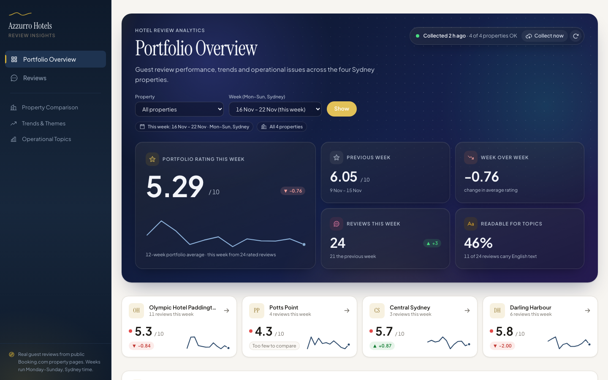

**Each hotel side by side, with its own change since last week.**

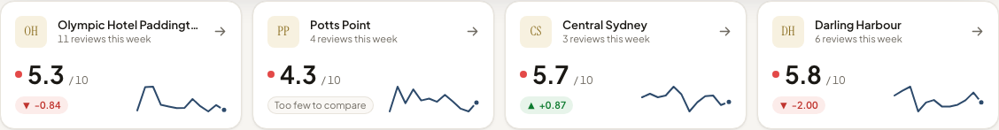

**Where the hotels are. Each pin is coloured by this week's rating and opens that hotel's reviews.**

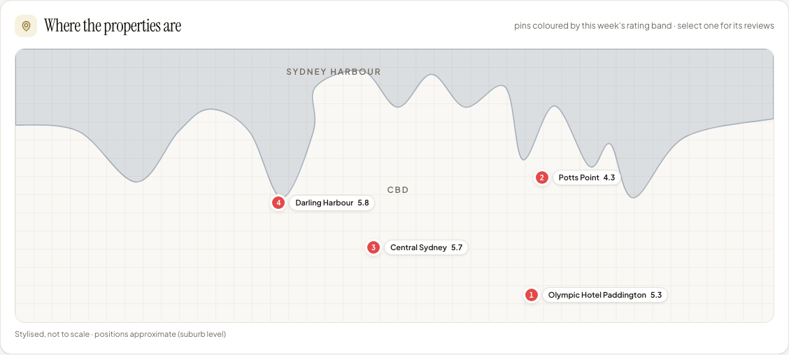

**Rating by hotel, the 12-week trend, and the latest reviews.**

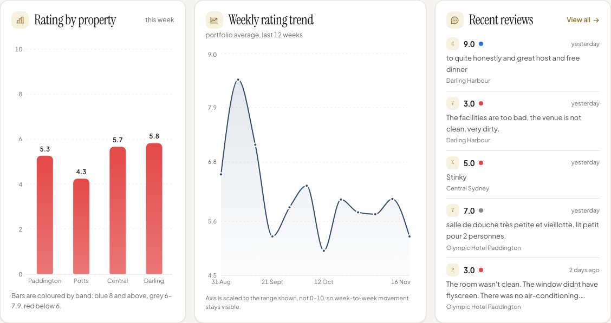

**Positive and negative trends: which topics guests complained about or praised more than last week.**

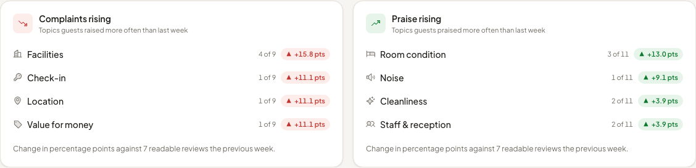

**Operational topics. The top line answers the brief's example question, e.g. "39% of the
18 reviews that week with a written complaint mentioned facilities (7 of 18)".**

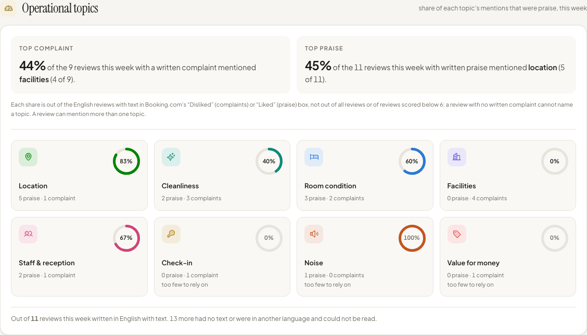

**The same Overview filtered to one hotel and a past week (Central Sydney, June 2025).**

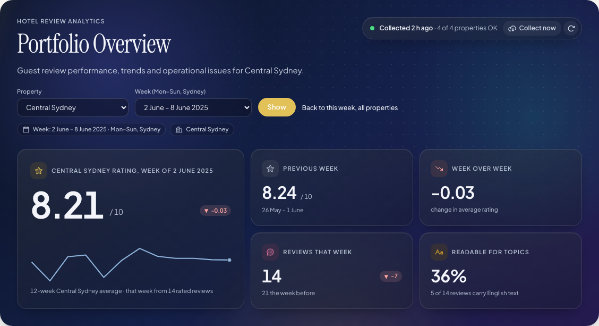

**Reviews page: every review, newest first, with filters.**

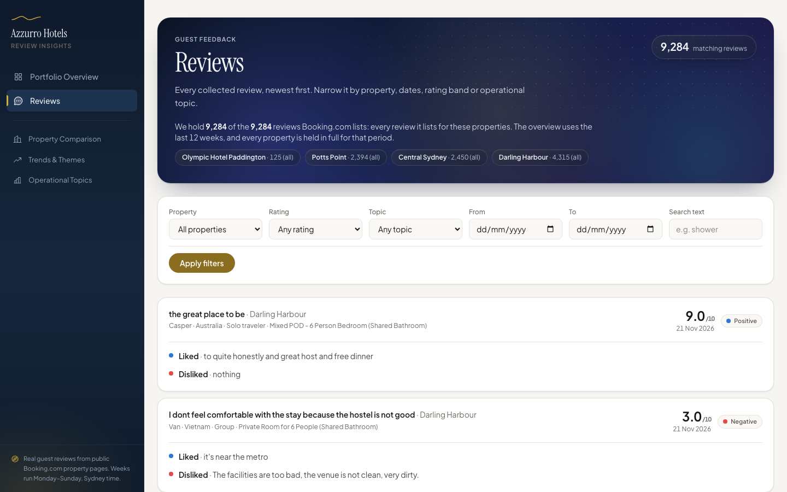

**Reviews filtered to cleanliness complaints at Darling Harbour.**

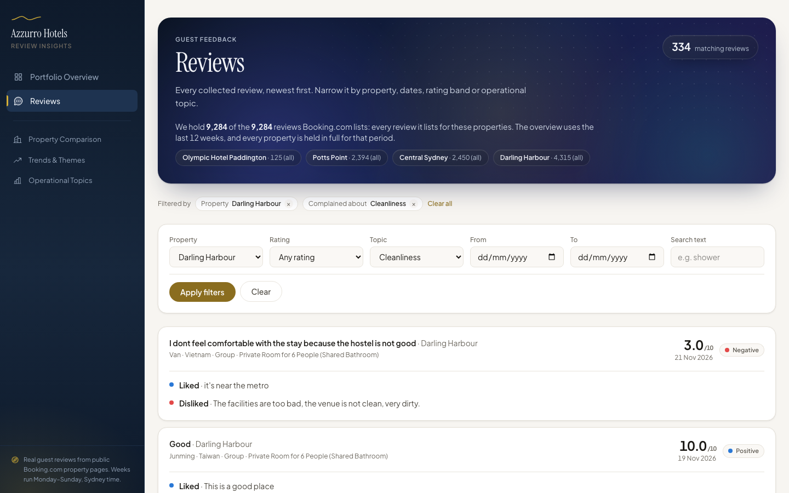

**Dark mode and phone layout.**

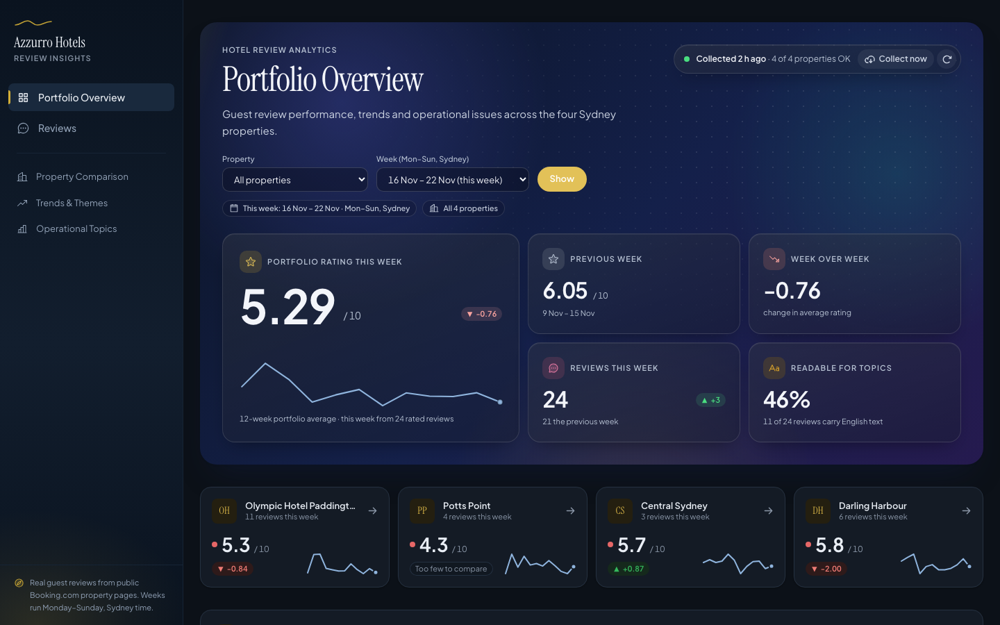

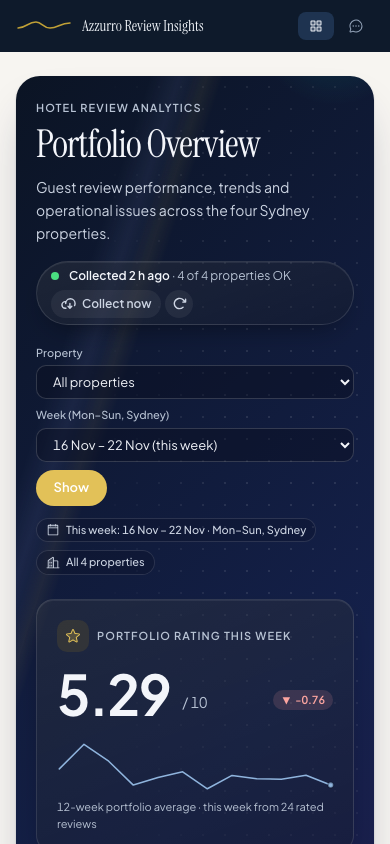

---

## Setup and installation

You need about **15 minutes** for this.

### What you need first

| Thing | Why | Where to get it |
| --- | --- | --- |
| **Node.js 20 or newer** (built and tested on 24) | runs everything | https://nodejs.org |
| **A free Supabase account** | the database that stores the reviews | https://supabase.com |
| **A computer with a screen** (Mac, Windows or Linux desktop) | the collector opens a real Chrome window (see [why](#how-reviews-are-collected)) | — |

### Step 1: Download and install

```bash
git clone https://github.com/RishabhBatra-01/azzurro-review-insights.git
cd azzurro-review-insights
npm install
npx playwright install chromium
```

The last line downloads the Chrome browser the collector uses.

### Step 2: Create the database

1. Sign in to Supabase and click **New project**. Any name, any region, any password.
2. When it is ready, open **SQL Editor** in the left menu.
3. Open each file below from the `supabase/migrations/` folder, paste its contents
   into the editor and click **Run**. **Do them in this order:**
   1. `0001_init.sql`: creates the tables
   2. `0002_grants.sql`: lets the app read and write them
   3. `0003_source_total.sql`: stores Booking.com's own review count on each run

### Step 3: Connect the app to the database

1. Copy the settings template:

   ```bash
   cp .env.example .env.local
   ```

2. In Supabase, go to **Project Settings → Data API** and **Project Settings → API Keys**.
3. Open `.env.local` and fill in these two lines:

   ```
   SUPABASE_URL=https://<your-project-ref>.supabase.co
   SUPABASE_SECRET_KEY=sb_secret_...
   ```

   The secret key is shown as `service_role` on older Supabase dashboards.
   **Keep it private.** `.env.local` is already excluded from Git.

Everything else in `.env.local` is optional and can stay empty for a local run.

---

## How to run the scraper and the dashboard

### 1. Collect reviews (the scraper)

```bash
npm run collect
```

What to expect:

- **A Chrome window opens by itself** and visits each hotel's Booking.com page.
  Leave it alone; it closes when finished.
- It collects up to the **300 newest reviews per hotel**, which takes a few minutes.
- At the end it prints a summary per hotel: how many were new and how many it already had.
- Running it again is safe. **Reviews are never stored twice**, and only new ones are added.

To collect **every** review (about 9,300, takes about 25 minutes):

```bash
npm run collect -- --full
```

### 2. Sort reviews into topics

```bash
npm run classify
```

This tags each review with topics such as Cleanliness or Noise. It takes a few
seconds and needs no internet beyond the database.

### 3. Start the dashboard

```bash
npm run dev
```

Open **http://localhost:3000** in your browser.

For a production build instead:

```bash
npm run build
npm start
```

### Optional: a "Collect now" button on your local dashboard

Add `ENABLE_UI_COLLECTION=1` to `.env.local` and restart `npm run dev`. A
**Collect now** button appears at the top right of the Overview. It runs the
same collector, and a Chrome window opens while it works.

### All commands

| Command | What it does |
| --- | --- |
| `npm run collect` | collect the newest reviews (up to 300 per hotel) |
| `npm run collect -- --full` | collect the full history (about 25 minutes) |
| `npm run collect -- --property olympic-paddington` | collect one hotel only |
| `npm run collect -- --max 600` | change the 300-per-hotel limit |
| `npm run classify` | tag new reviews with topics |
| `npm run classify -- --all` | re-tag every review (after changing the topic word lists) |
| `npm run dev` | start the dashboard at http://localhost:3000 |
| `npm run build` then `npm start` | production build and server |
| `npm run health` | compare our stored averages with the score Booking.com shows |
| `npm run export` | write all stored reviews to `data/sample-reviews.json` |
| `npm test` | run the automated tests (98 tests) |
| `npm run typecheck` | check the code for type errors |

### Sample data

`data/sample-reviews.json` holds **1,925 real collected reviews** across all four
hotels (exported on 21 Nov 2026), so the data can be inspected without running
anything. Run `npm run export` to replace it with everything currently in your database.

### How the live demo is deployed (optional)

You do not need this to run it locally.

- **Dashboard:** Vercel, reading from the same Supabase database.
- **Daily collection:** GitHub Actions (`.github/workflows/collect.yml`) runs the
  collector every day at 7am Sydney on a virtual screen, then tags the new reviews.
  It needs the repository secrets `SUPABASE_URL` and `SUPABASE_SECRET_KEY`
  (and optionally `SEARCHAPI_API_KEY`, see below).
- **The live "Collect now" button** asks GitHub to start that same job. On Vercel
  it needs `GITHUB_REPO` (`owner/repo`) and `GITHUB_DISPATCH_TOKEN` (a GitHub token
  for this repository only, with **Actions: Read and write**).

---

## Architecture

```
  Booking.com hotel pages (public)
            │
            │  1. COLLECT: a real Chrome browser opens each page and reads the reviews
            ▼
  src/collector/   check every review, drop repeats, record the run
            │
            ▼
  Supabase (Postgres database)
     • review          the reviews exactly as collected (the source of truth)
     • review_topic    topic tags worked out from the text (can be rebuilt anytime)
     • collection_run  a record of every collection attempt, success or failure
            │
            │  2. ANALYSE: plain calculations, no database or web code inside
            ▼
  src/insights/    weeks, averages, comparisons, topic tagging
            │
            │  3. SHOW: pages are built on the server and sent as finished HTML
            ▼
  src/app/  +  src/components/    the dashboard (Next.js)
```

**Technology:** Next.js 16 and React (dashboard), TypeScript, Supabase/Postgres
(database), Playwright (browser for collection), Vitest (tests), Vercel (hosting),
GitHub Actions (daily collection).

**Folders**

| Folder | What is in it |
| --- | --- |
| `src/collector/` | the scraper: opens the pages, reads reviews, validates them, saves them |
| `src/db/` | all database access. The only code that talks to Supabase |
| `src/insights/` | the maths: week boundaries, averages, rating bands, topic tagging |
| `src/app/` | the pages: Overview (`page.tsx`), Reviews (`reviews/page.tsx`), and the collect API |
| `src/components/` | building blocks for the pages: charts, cards, map, filters |
| `supabase/migrations/` | the database setup scripts from Step 2 |
| `tests/` | automated tests |
| `data/` | sample review data and test fixtures |
| `docs/` | screenshots and detailed write-ups |

**Design choices that keep it reliable**

- **The browser never talks to the database.** Pages are built on the server, so no
  database key ever reaches a visitor's browser.
- **The maths is separate from everything else.** `src/insights/` has no database
  or web code, so every calculation can be tested on its own.
- **Collected reviews and worked-out tags are kept apart.** If the topic rules
  change, tags are rebuilt without touching a single review.
- **The scraper is separate from the website.** The website can start a collection
  but never contains the scraping code itself.

---

## How reviews are collected

### The problem

Booking.com offers no API to the hotels' operations team, and the review pages
are protected:

- **A plain web request gets blocked.** Booking.com returns a security check
  ("AWS WAF challenge") instead of the page.
- **Reviews are not in the page's HTML.** They load only after the page's own
  scripts run and someone clicks "Read all reviews".
- **The usual review address is off-limits.** Booking.com's `robots.txt` disallows
  `/hotelfeaturedreviews/`, which most scrapers use. **This project never requests it.**

### The method

1. Open the public hotel page in a **real Chrome browser** (Playwright).
2. Click "Read all reviews", just as a person would. The page then asks Booking.com
   for its reviews itself.
3. Watch for that request, then **repeat it page by page** inside the same browser
   to read the rest of the reviews.

Nothing is faked. There is no CAPTCHA solving, no rotating proxies and no invented
credentials. If the browser cannot get the reviews normally, the run fails and says why.

**Why a visible browser window?** Booking.com rejects browsers that run without
a screen ("headless"): the review request returns `Request not supported`. With a
normal visible browser, the same code works. On GitHub Actions it runs on a
virtual screen.

### What is collected for each review

Review score · review date and time · title · "liked" text · "disliked" text ·
language · the hotel's reply · reviewer first name and country · guest type
(solo, couple, family…) · room type · number of nights · check-in and check-out
dates · helpful votes. Profile photos are deliberately not stored.

### No duplicates, and only new reviews on each run

- **The database itself refuses duplicates.** Each review is stored under
  Booking.com's own review ID, and a second copy updates the first instead of
  being added. Running the collector twice adds nothing the second time.
- **Repeats within one run are removed before saving.** If a guest posts while a
  run is in progress, the list shifts and a review can appear on two pages.
- **Routine runs read newest first and stop early.** After 20 reviews in a row
  that are already stored, the run stops, so a daily run takes seconds per hotel.

### When things go wrong

- **One hotel failing never stops the others.** Each hotel is collected and saved separately.
- **A failed run never deletes anything.** Every attempt is recorded as `ok`,
  `partial` or `failed`, and the dashboard shows a green or red status dot.
- **The page loads slowly:** the collector retries the "Read all reviews" click up
  to three times.
- **The session expires** (after roughly 30 minutes): it reloads the page once and continues.
- **Bad data is rejected.** Every review is checked (a score between 0 and 10, a
  real date, and so on). If more than 20% of a batch fails the check, the whole batch is refused
  rather than storing an unreliable slice.
- **Silent breakage is caught.** If a hotel that lists thousands of reviews returns
  none, the run fails. `npm run health` compares our averages with Booking.com's
  published scores as an outside check.
- **Backup source (optional).** If the browser method fails for a hotel and
  `SEARCHAPI_API_KEY` is set, that hotel's newest reviews are fetched through
  [SearchApi](https://www.searchapi.io/docs/booking-reviews-api), a paid
  third-party service. It returns Booking.com's own review IDs, so nothing is
  duplicated, and its data passes the same checks.

### How data stays fresh

| | Where | When |
| --- | --- | --- |
| **Automatically** | GitHub Actions | every day at 7am Sydney |
| **On demand** | **Collect now** button on the dashboard | any time (one run at a time, at least 5 minutes apart) |
| **Locally** | `npm run collect` | whenever you run it |

Full detail, including what was tried, a wrong turn and how it was resolved, and
the health check results: [docs/collection.md](docs/collection.md).

---

## How the insights work

### Definitions used everywhere

| Term | Meaning |
| --- | --- |
| **Week** | Monday 00:00 to Sunday 23:59, **Sydney time** |
| **This week** | the week containing today in Sydney (or the week picked on the Overview) |
| **Date** | the date the review was written, not the stay date |
| **Positive review** | score **8.0 or more** |
| **Neutral review** | score **6.0 to 7.9** |
| **Negative review** | score **below 6.0** |
| **Too few to compare** | fewer than **3** rated reviews. No average or change is shown, to avoid misleading numbers |

### Topics: keyword-based, no AI model

Booking.com asks guests to write in two separate boxes: **Liked** and **Disliked**.

- Each of the 8 topics (Cleanliness, Check-in, Staff & reception, Noise, Facilities,
  Location, Room condition, Value for money) has a list of words and phrases,
  e.g. Cleanliness: *dirty, stain, mould, smell, spotless…*
- A topic word in the **Disliked** box counts as a **complaint**; in the **Liked** box, as **praise**.
- So "great location, noisy room" gives *location: praise* and *noise: complaint*.
- The word that triggered each tag is saved, so every tag can be explained.

**Why keywords and not AI:** Booking.com's Liked/Disliked split already tells us
praise from complaint, and keyword rules are free, explainable, give the same
answer every time and are covered by tests.

### Every percentage says what it is out of

About 40% of reviews have no written text, and many are not in English, so a
percentage of "all reviews" would understate every topic. The dashboard always
shows the count and the base:

> **39%** of the 18 reviews that week with a written complaint mentioned **facilities** (7 of 18).

"With a written complaint" means text in the Disliked box, not a score below 6:
a low score with no text cannot name a topic.

Full method, measured accuracy and the fixes made after checking real tags:
[docs/insights.md](docs/insights.md).

---

## Known limitations and assumptions

### Collection

- **It needs a visible browser.** Booking.com refuses headless browsers, so
  collection is slower than a simple web request and needs a screen (or a virtual one).
- **It relies on an interface Booking.com does not document.** If Booking.com
  changes its page, collection for that hotel fails loudly with the reason in the
  log, and the status dot turns red. The fix is a code update. The backup source
  covers the newest reviews in the meantime, if it is configured.
- **Booking.com's Terms of Service restrict automated access**, whatever
  `robots.txt` allows. This is a trial demonstration. **For real production use,
  the hotel owner should use the Booking.com Extranet or the Connectivity Review
  API** through a PMS or channel-manager partner, which needs the owner's access.
- **Only about three years of reviews exist on Booking.com.** The oldest is from
  November 2023. Our counts match Booking.com's exactly, so nothing older can be collected.
- **Edited or removed old reviews are not picked up by the daily run**, because
  it stops once it reaches reviews it already has. A `--full` run re-reads
  everything (about 25 minutes). Reviews Booking.com removes stay in our database.
- **No automatic retry after a network timeout.** The hotel is marked failed for
  that run and is tried again at the next daily run, or with **Collect now**.
- **The backup source has limited paid credits** (10 reviews per credit). When
  they run out, a browser failure simply means that hotel is marked failed for that run.

### Insights

- **Topics work for English only.** About 44% of all reviews are readable for
  topics: 40% have no text, and the rest are in other languages. Ratings and
  trends still use 100% of reviews.
- **Keyword matching has natural limits.** It misses reworded complaints (e.g.
  "the bathroom wasn't looked after"), cannot tell "not clean" from "very clean",
  and trusts the box the guest wrote in. So "None, everything was clean" typed in
  the Disliked box counts as a complaint. This affects 12 of 9,902 tags.
- **Accuracy was checked by reading samples**, not by a formally labelled test set.

### Assumptions

- **Weeks run Monday to Sunday in Sydney time**, and a review belongs to the
  week it was written in.
- **"Positive", "neutral" and "negative" come from the guest's score** (8+ / 6–7.9 / below 6), not from the text.
- **Booking.com's published score is weighted towards recent reviews**, so our
  all-time averages can differ from it. Ours is a plain average. For three hotels
  ratings fell sharply in 2026, which explains a difference of about 1 point (see
  [docs/collection.md](docs/collection.md)).
- **Small hotels have quiet weeks.** Olympic Paddington has 125 reviews in total,
  so some weeks show "Too few to compare" instead of a misleading number.
- **Reviewer names are first names only**, as Booking.com publishes them.

### Not done

- No automated end-to-end browser tests of the dashboard. Pages were checked by
  scripted browser runs during development.

---

## Troubleshooting

| Problem | What to do |
| --- | --- |
| `Missing SUPABASE_URL or SUPABASE_SECRET_KEY` | `.env.local` is missing or incomplete. Repeat [Step 3](#step-3-connect-the-app-to-the-database) |
| A `permission denied` error from the database | migration `0002_grants.sql` was not run. Run it in the Supabase SQL Editor |
| The dashboard is empty | no reviews collected yet. Run `npm run collect`, then `npm run classify` |
| `could not capture a ReviewList request` | Booking.com did not load the reviews in time. Run it again. If it keeps failing, open the hotel page in a normal browser to check it loads |
| The collector fails on a server with no screen | Booking.com refuses headless browsers. Use a desktop, or a virtual screen: `xvfb-run --auto-servernum npm run collect` (Linux) |
| Topic numbers look out of date | run `npm run classify -- --all` |

---

## Security

- **No secrets in the code.** `.env.local` is excluded from Git, and keys for the
  live site are stored in Vercel and GitHub secrets.
- **No key reaches the browser.** Pages are built on the server, and only `src/db/`
  talks to the database.
- **The database is locked down.** Row-level security is on for every table with
  no public access. An anonymous request gets `401`.
- **User input is cleaned** before it is used in a database search.
- **The "Collect now" button is protected:** same-site requests only, one run at a
  time, and at least 5 minutes between runs.

---

## Further reading

- [docs/collection.md](docs/collection.md): everything tried for collection, the
  evidence, the backup source and the health check results
- [docs/insights.md](docs/insights.md): topic method, language handling, how
  percentages are calculated and the measured classifier quality
- [docs/design.md](docs/design.md): why the interface looks and behaves the way it does
